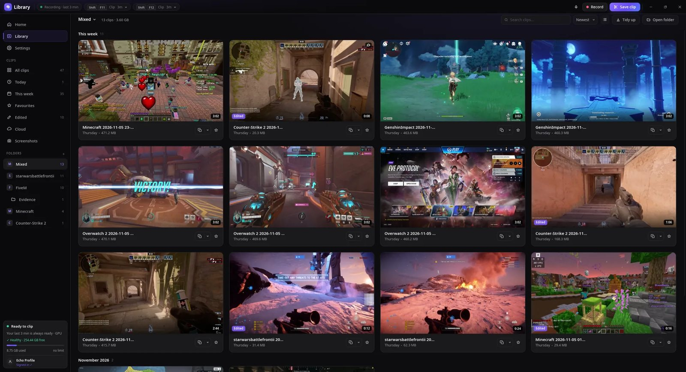
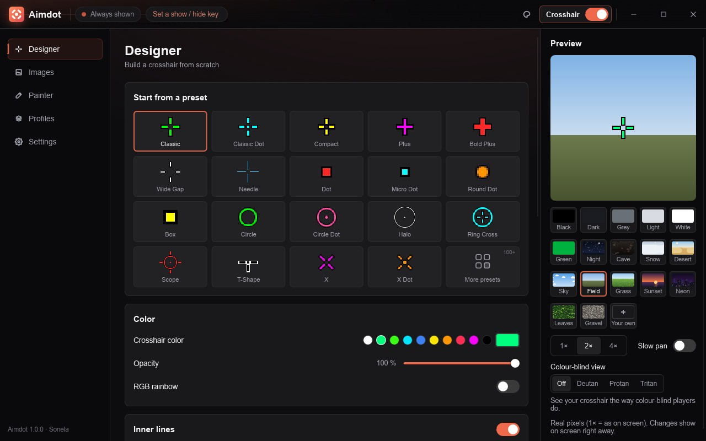

  

<h1 align="center">Sonela</h1>

<b>Free tools for PC gamers that stay out of your game's way.</b>

  Light on your PC. No ads, no accounts. Open source. Windows and Linux. 
  <a href="https://sonela.app">sonela.app</a> · <a href="https://discord.gg/JPVewEfUQs">Discord</a>

 

<h2 align="center">Echo</h2>

  Records your game in the background. Press one key to save the last moments, 
  then trim them and share them on Discord. Uses about 150 MB of memory while recording.

  <a href="https://echoclip.link/download"><b>Download Echo</b></a> ·
  <a href="https://echoclip.link">echoclip.link</a> ·
  <a href="https://github.com/Resister0/echoclip">Code on GitHub</a>

  

 

<h2 align="center">Aimdot</h2>

  Your own crosshair on top of any game. Pick one of 120+ presets, design your own 
  or paint it pixel by pixel - one per game, and on or off with one key.

  <a href="https://sonela.app/aimdot#download"><b>Download Aimdot</b></a> ·
  <a href="https://sonela.app/aimdot">sonela.app/aimdot</a> ·
  <a href="https://github.com/Resister0/aimdot">Code on GitHub</a>

  

 

<h2 align="center">Lasso</h2>

  Draw around any part of the screen, mark it up, 
  then copy, save or share it.

<b>Coming soon</b> · <a href="https://sonela.app/lasso">sonela.app/lasso</a>

 

<h2 align="center">Get in touch</h2>

  Questions, bugs and ideas: the <a href="https://discord.gg/JPVewEfUQs">Discord</a> or
  <a href="mailto:support@echoclip.link">support@echoclip.link</a>.

 

Echo and Aimdot are GPL-3.0. This repo is also the code of sonela.app (<a href="LICENSE">MIT</a>).

